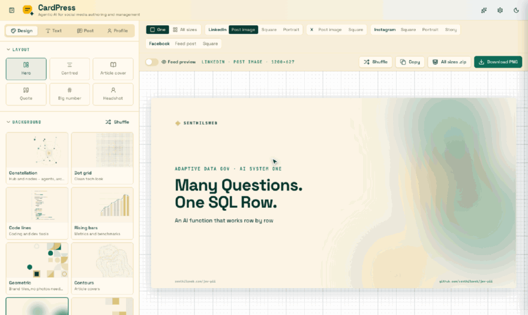

# CardPress

> Open-source, self-hosted agentic AI for social media authoring and management: design branded cards, draft posts with an assistant, preview them, then publish or schedule. One Go binary with the web app embedded.



**Status.** The card designer, post composer, full preview, encrypted credential storage and the scheduler are built and tested. Publishing to LinkedIn is tested against a local fake of LinkedIn's API, **not yet against a real LinkedIn account**, so treat the first real post as a trial. X and Instagram credentials can be stored but those networks cannot be published to yet. The chat that drafts post content from an article works end to end, but with a built-in demo agent rather than an AI model. The real Claude Managed Agent is specified in [`openspec/changes`](openspec/changes) but not built; the MCP server it will use is.

Make social media cards for LinkedIn, X, Instagram and Facebook in your own style. Type a title, pick a layout and a background, and download the PNG in every size.

Cards are drawn and exported in the browser. Your profile, drafts and preferences are saved by the Go server in a database (a local SQLite file, or Turso when hosted). Nothing is kept in browser storage. See [Deployment](docs/deployment.md).

## What it does

- **Profiles**: your name, handle, website, logo, headshot, fonts and colour sets. One profile, with 28 colour sets to choose from. Export and import them as JSON.
- **6 layouts**: Hero, Centred, Article cover, Quote, Big number, Headshot.
- **11 backgrounds**, all drawn in code as SVG, so exports stay sharp and there are no stock photo licences to worry about. **Shuffle** gives a new variation each time:
  Constellation, Dot grid, Code lines, Rising bars, Geometric, Contours, Gradient mesh, Photo mosaic (your photos), Browser frame (your app screenshot), Own image, Plain.
- **10 sizes**:

  | Network | Sizes |
  |---|---|
  | LinkedIn | 1200×627, 1200×1200, 1080×1350 |
  | X | 1600×900, 1080×1080 |
  | Instagram | 1080×1080, 1080×1350, 1080×1920 |
  | Facebook | 1200×630, 1080×1080 |

  These are common recommended sizes. Platforms change them from time to time, so edit `web/src/lib/sizes.ts` if needed.
- **Post composer**: write the post or article in a rich-text editor (lists, hashtags, alt text), check it in a full preview of the LinkedIn feed, and copy it. Drafts are saved on the server. See [Post authoring](docs/post-authoring.md).
- **Chat for content**: give it a web address or some text and it drafts a post or article for you to approve, edit or reject, then revise by replying. It prepares content only and never publishes. It uses a built-in demo agent for now (no AI model); the real agent plugs in later. See [Chat](docs/chat.md).
- **MCP server**: an outside AI agent can read drafts and job status, read public web pages, and propose content that waits for your approval. It cannot publish, schedule, change drafts or touch credentials, and every call is audited. Over HTTP at `/mcp` or `cardpress mcp` over stdio. See [MCP](docs/mcp.md).
- **Publish and schedule**: from the Full preview, post to LinkedIn now or at a chosen time (with the card image), with a queue, per-post status, and no automatic retries. See [Publishing](docs/publishing.md).
- **Feed preview**: shows the card inside a plain post frame with your post text, plus a character count for each network.
- **Export**: download a PNG, copy the image to the clipboard, or download all sizes as one zip.

## Stack

| Part | Choice |
|---|---|
| Site | [Astro](https://astro.build) (static output) |
| UI | React island, [shadcn/ui](https://ui.shadcn.com) components (Radix + Tailwind CSS v4), [Lucide](https://lucide.dev) icons |
| Fonts | Space Grotesk, Inter, JetBrains Mono, self-hosted through Fontsource (works offline) |
| Export | [html-to-image](https://github.com/bubkoo/html-to-image), [JSZip](https://stuk.github.io/jszip/) |
| Server | One Go binary with the built site embedded (`go:embed`), a JSON API under `/api/v1`, SQLite or Turso/libSQL |

## Run it

### Development

```bash
cd web && npm install && cd ..
make dev             # Go API on :8080, Astro on http://localhost:4321
make test            # Go tests, web type check and unit tests
```

### One binary (no Docker)

Needs Node 22+ and Go 1.22+.

```bash
make build           # builds web/dist and bin/cardpress
./bin/cardpress                 # http://localhost:8080 (landing page; the editor is at /studio/)
./bin/cardpress -addr 127.0.0.1:9000   # another port
```

`make release` cross-compiles for macOS, Linux and Windows into `dist/`.

### Docker

Images are built by GitHub Actions. To build locally anyway:

```bash
make docker
make docker-run      # http://localhost:8080
```

### Serve under a sub-path

To host it under a path such as `/studio/social-cards`, build and run with the same base path:

```bash
make build BASE_PATH=/studio/social-cards
./bin/cardpress -base /studio/social-cards
```

The server listens on loopback only by default and refuses to expose the API without a token. Configuration is in [Deployment](docs/deployment.md). `/healthz` returns `ok <version>`.

## Project layout

```
.
├── main.go                 # Go server: wiring, embeds web/dist
├── internal/               # config, store (SQLite/libSQL + migrations), service (rules), api (HTTP)
├── Dockerfile              # node build -> go build -> distroless image
├── Makefile
└── web/                    # Astro app
    ├── components.json     # shadcn config (add more components with the shadcn CLI)
    └── src/
        ├── card/           # the card renderer: Card.tsx (layouts) and backgrounds.tsx
        ├── components/
        │   ├── studio/     # editor UI: panels, preview, fields
        │   └── ui/         # shadcn components
        ├── lib/            # profiles, palettes, sizes, export, API client
        ├── layouts/Base.astro
        ├── pages/index.astro
        └── styles/global.css   # senthilsweb.com tokens mapped to shadcn variables
```

### Add a background

Add a function to `web/src/card/backgrounds.tsx` that returns SVG elements, and add it to the `BACKGROUNDS` list. It receives the canvas size, the area where the art should sit, the colour set and a seeded random function (so Shuffle works).

### Add a profile or colour set

Use the **Profile** tab in the app, or change `DEFAULT_PROFILES` in `web/src/lib/profiles.ts`.

## Licence

MIT

## Docs

See [docs/](docs/README.md): adding backgrounds, palettes, fonts, and the AI-DLC and OpenSpec records.
