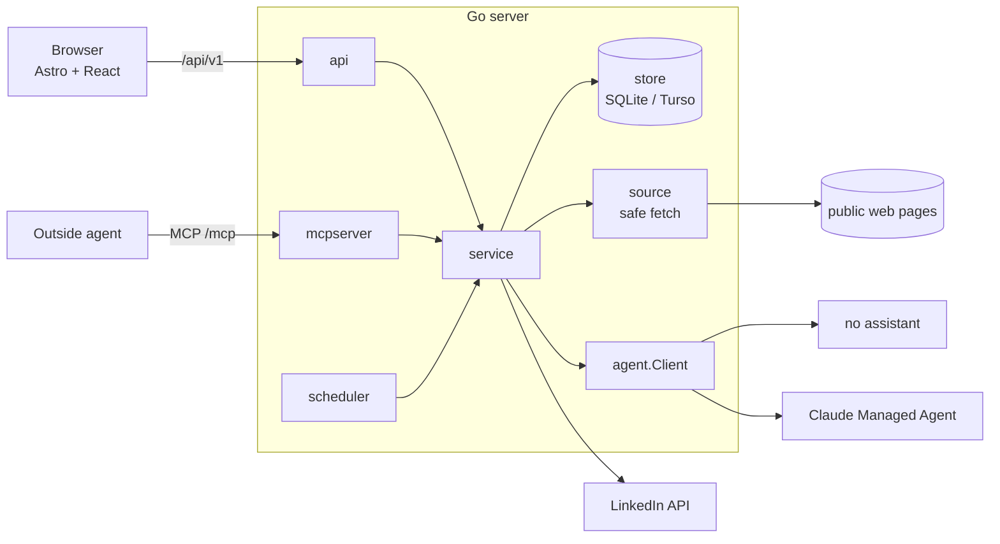
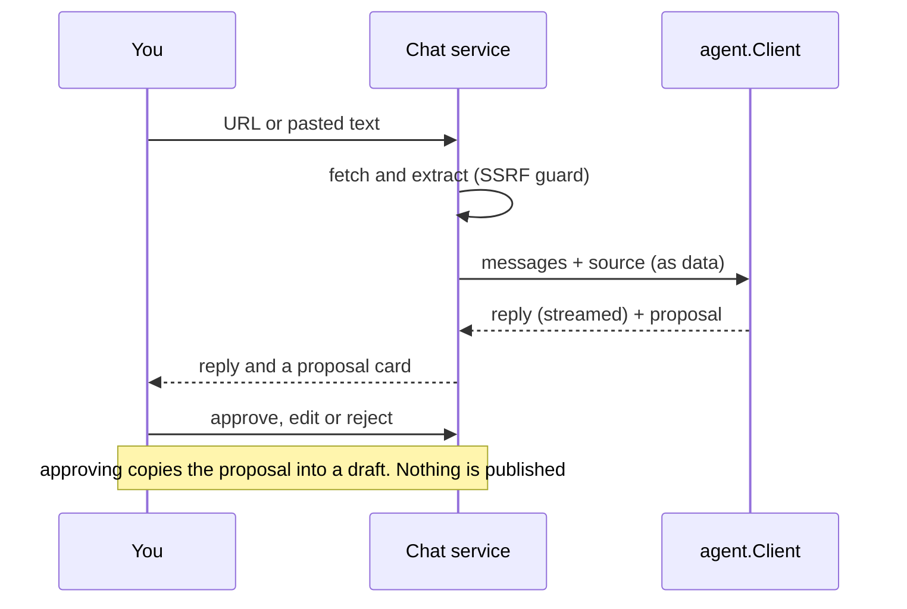
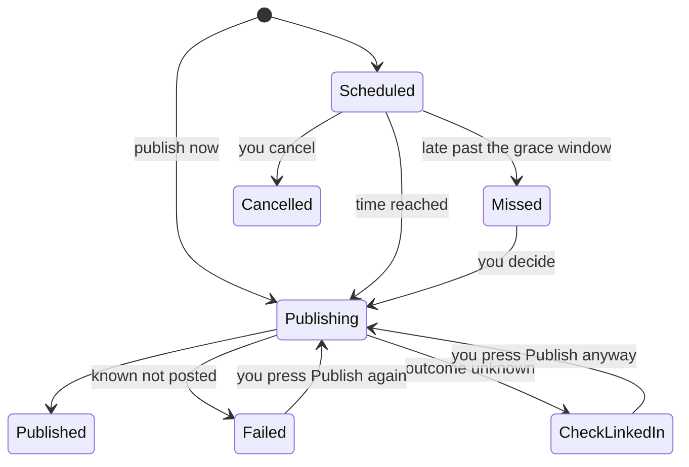

# Architecture

One Go process serves the web app, the JSON API, the MCP endpoint and the scheduler, and keeps everything in one database.

## What runs where

- **In the browser**: the card is drawn and exported (PNG, zip) here, using SVG. The server never renders a card, except that a publish job stores the PNG the browser made.
- **In the Go server**: all saved state, the encrypted credentials, publishing, the scheduler, the chat and the MCP tools.
- **Outside**: LinkedIn (publishing), public web pages (fetched for the assistant), and optionally Anthropic (the managed agent).

## Data

Profiles (brands), designs, preferences, drafts and their versions, credentials, publish jobs and attempts, conversations, accounts (users, roles, sessions, API keys) and the MCP audit log are in one database. Drafts, designs, jobs, conversations and credentials are keyed by brand; a brand belongs to the person who made it. The schema is built by numbered migrations at start (`0001` to `0015`); see [Data model](data-model.md). Credentials are encrypted with a key from `CARDPRESS_SECRET_KEY` or a key file; the API only ever returns the last four characters of a secret.

## The assistant

With the managed agent, one session lives per conversation, and the agent returns its proposal by calling a `propose_content` tool that is validated like any other. See [Claude Managed Agent](cma-agent.md).

## Publishing

The scheduler is not a library: it is a loop in the Go server that wakes every 20 seconds, claims each due job with one atomic database update, and publishes it. The server has to be running at the scheduled time. A post later than the grace window is marked Missed and waits for you, and a publish with an unknown outcome is flagged Check LinkedIn. See [Publishing](publishing.md).

## Security model

- **Accounts first.** Once an account exists, every route needs a sign-in, an API key or the machine token; the server answers for another person's item as if it were not there. Roles (admin, editor, writer) decide what a person may do. Passwords, sessions and API keys are stored only as hashes. See [Accounts and roles](accounts.md).
- Loopback by default. A non-loopback address needs `CARDPRESS_API_TOKEN` (or an explicit opt-out).
- Without a token, only `localhost` host names are accepted and cross-site browser requests that change data are refused.
- Every address the server fetches is checked after DNS resolution and on each redirect.
- The MCP server gets narrow tools, no publishing and no credentials, and every call is recorded with redacted arguments. Over HTTP it needs an API key (which stays inside its person's brands) or the machine token.
- Public pages are rendered by the server from approved items only, with a content security policy and no scripts.
- The managed agent has no built-in tools and no network.

## Decisions

Each piece of work has a proposal in [`openspec/changes`](https://github.com/senthilsweb/cardpress/tree/main/openspec/changes) and a record in the [AI-DLC record](ai-dlc/README.md).
