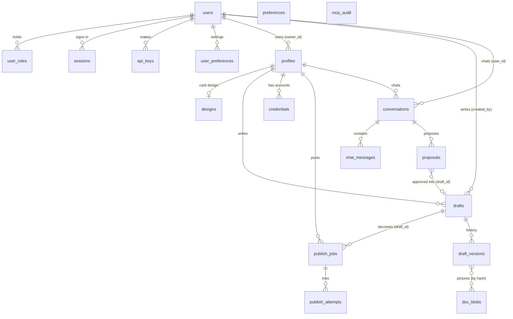
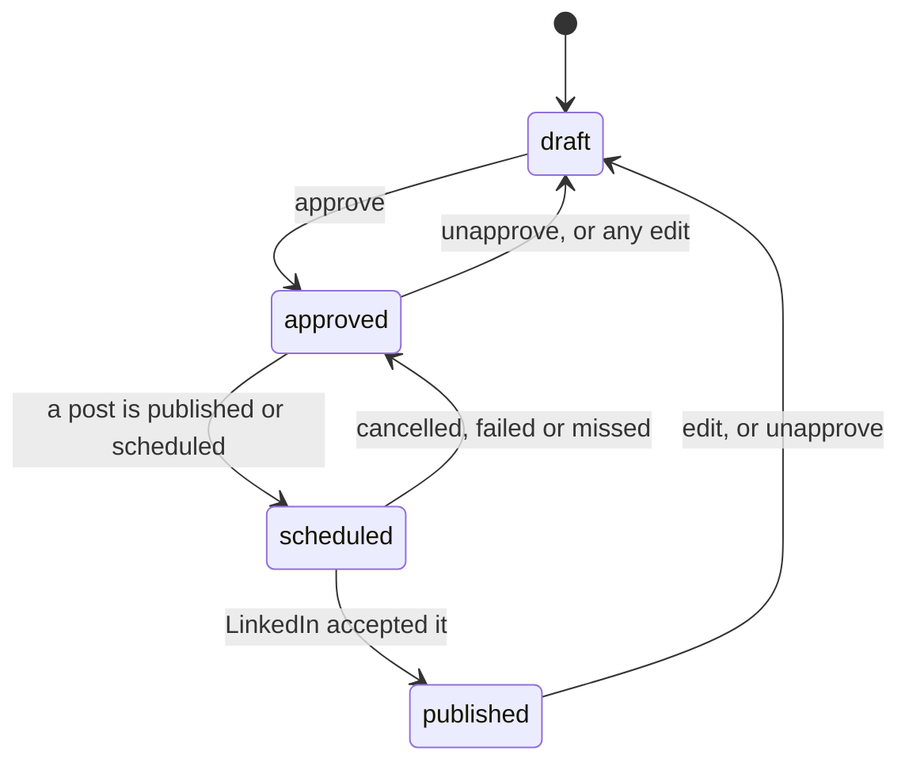

# Data model

CardPress keeps everything in one database: SQLite in a file by default, or Turso (libSQL) with `CARDPRESS_DB`. The schema is made of numbered migrations in `internal/store/migrations/`, applied in order at start-up and recorded in `schema_migrations`. This page describes the schema as it is (migrations 0001 to 0016). **It is updated with every migration.**

## Conventions

- Ids are 16 hex characters made by the server (`newID`). A brand's id is chosen when it is created.
- Times are UTC text in RFC 3339 (`2026-11-24T17:43:50Z`); drafts keep milliseconds. Text sorts correctly, so no date type is needed.
- Structured values are JSON text (`hashtags`, `doc`, `data`, `steps`). The shape of each is below. The server validates them on the way in.
- A brand owns its rows through `profile_id`, and a person owns their brands through `profiles.owner_id`. There are no database foreign keys: the services delete rows together (see `DeleteProfile`), inside one transaction, and every read narrows by owner in the query itself, so a row that is not yours is never returned.
- Person columns (`owner_id`, `created_by`, `approved_by`, `user_id`) hold a `users.id`. They are **empty for rows that predate accounts**, which the first account adopts.
- Secrets are never stored in plain text: `credentials.value` is sealed with the secret key (AES-GCM, tied to its network and field). Passwords (`users.password_hash`, argon2id), session cookies (`sessions.token_hash`) and API keys (`api_keys.key_hash`, SHA-256) are stored only as hashes; the value itself cannot be read back.

## Relationships

Rows are owned by a person through `owner_id`, `created_by` and `user_id`, shown as the `users` lines. `drafts.approved_by` and `publish_jobs.created_by` also hold a user id.

## Tables

### Brands and look

| Table | Migration | Columns |
|---|---|---|
| `profiles` | 0001, 0007, 0011 | `id` (PK), `position`, `data` (JSON: name, handle, website, logo, fonts, colour sets), `updated_at`, `archived_at` (set when a brand is archived, empty otherwise), `owner_id` (who made it; empty for brands that predate accounts, which the first account adopts) |
| `designs` | 0001 | `profile_id` (PK), `data` (JSON: the brand's current card design), `updated_at` |
| `preferences` | 0001 | `key` (PK), `value` (JSON), `updated_at`. Keys: `theme`, `layout`, `customFonts`, `activeProfile`, `envProfile` |

`envProfile` names the brand that the `CARDPRESS_<NETWORK>_<FIELD>` environment variables belong to. It is set when the first brand is saved and is never moved.

### Writing

| Table | Migration | Columns |
|---|---|---|
| `drafts` | 0002, 0009, 0014, 0019 | `id` (PK), `revision` (moves with every change to what the draft says or shows), `profile_id`, `kind` (`post` or `article`), `status` (`draft`, `approved`, `scheduled`, `published`), `doc` (JSON, the editor's rich text), `hashtags` (JSON array), `alt_text`, `unicode_styles` (0/1), `title`, `design` (JSON, the card), `design_version`, `approved_at`, `scheduled_at`, `timezone`, `slug`, `summary`, `page_at`, `cover` (BLOB), `attachment_kind` (`card`, `image`, `document`, `images` or `video`), `attachment` (BLOB, the post's own file), `attachment_type`, `attachment_title`, `video_url`, `video_size`, `created_by`, `approved_by` (user ids), `created_at`, `updated_at`. Indexes `(profile_id, updated_at DESC)`, `(profile_id, status, updated_at DESC)`, unique `(kind, slug)` where `slug` is set, and `(kind, page_at DESC)` for live pages |

`doc` is a TipTap/ProseMirror document: `{"type":"doc","content":[{"type":"paragraph","content":[{"type":"text","text":"…"}]}]}`. It is limited to 25 MB, because an article keeps its images inside its text as base64 (`{"type":"image","attrs":{"src":"data:image/png;base64,…"}}`).

### Publishing

| Table | Migration | Columns |
|---|---|---|
| `publish_jobs` | 0004 | `id` (PK), `profile_id`, `draft_id`, `network` (`linkedin`), `status`, `body`, `hashtags` (JSON), `alt_text`, `image` (BLOB, the card PNG), `scheduled_at`, `timezone`, `error`, `post_urn`, `post_url`, `created_by`, `created_at`, `updated_at`, `published_at`. Indexes `(status, scheduled_at)` and `(profile_id, created_at DESC)` |
| `publish_attempts` | 0008 | `id` (PK), `job_id`, `started_at`, `finished_at`, `outcome`, `error`, `steps` (JSON). Index `(job_id, started_at)` |
| `credentials` | 0003, 0007 | `profile_id`, `network`, `field`, `value` (sealed), `updated_at`. Primary key `(profile_id, network, field)` |

A job is a snapshot: its `body`, `hashtags`, `alt_text` and `image` are copied when it is confirmed, so editing the draft later never changes what was sent. Statuses: `scheduled`, `publishing`, `published`, `failed`, `missed`, `needs_review`, `cancelled`.

`publish_attempts.steps` is a JSON array, one entry per call to LinkedIn: `{step, method, host, path, status, headers, body, error, at, ms}`. It holds LinkedIn's answer only: never the access token, and an upload address is kept without its query (it carries a signature). `headers` keeps a short list (`X-Restli-Id`, `X-Li-Uuid`, `Retry-After`, …).

### Assistant

| Table | Migration | Columns |
|---|---|---|
| `conversations` | 0005, 0011, 0017, 0022 | `id` (PK), `user_id`, `profile_id`, `title`, `session_id`, `source_kind`, `source_url`, `source_title`, `source_text`, `source_truncated`, `post_draft_id`, `article_draft_id`, `graded` (kinds whose first draft was checked), `seen` (each item as the assistant last saw it), `created_at`, `updated_at` |
| `agent_memories` | 0019 | `profile_id`, `key` (PK together), `content`, `created_by`, `created_at`, `updated_at` |
| `draft_versions.revision` | 0021 | the state of the draft a version holds |
| `chat_usage` | 0020 | `id` (PK), `conversation_id`, `message_id`, `session_id`, `total_cents` (the session's running total), `added_cents`, `active_seconds`, `created_at` |
| `conversation_sources` | 0018 | `id` (PK), `conversation_id`, `message_id`, `kind` (`url`, `text`, `md`, `docx`, `pdf`), `name`, `url`, `chars`, `truncated`, `text`, `data` (a PDF as attached), `delivered`, `created_at` |
| `chat_messages` | 0005 | `id` (PK), `conversation_id`, `seq`, `role` (`user` or `assistant`), `content`, `created_at`, `status` (`done`, `failed` or `stopped`), `detail` (JSON: steps, saved versions, check results, error). Unique `(conversation_id, seq)` |
| `proposals` | 0005 | `id` (PK), `conversation_id`, `message_id`, `kind`, `title`, `body`, `hashtags`, `alt_text`, `rationale`, `status` (`pending`, `approved`, `rejected`), `edited`, `original`, `draft_id`, `created_at`, `decided_at` |

### Outside agents

| Table | Migration | Columns |
|---|---|---|
| `mcp_audit` | 0006 | `id` (autoincrement), `at`, `transport`, `caller`, `tool`, `args`, `outcome` (`ok` or `error`), `detail` |

## Migration history

| No. | Adds |
|---|---|
| 0001 | `profiles`, `designs`, `preferences` |
| 0002 | `drafts` |
| 0003 | `credentials` (one set per network) |
| 0004 | `publish_jobs` |
| 0005 | `conversations`, `chat_messages`, `proposals` |
| 0006 | `mcp_audit` |
| 0007 | Brands: `credentials` keyed by brand, `profiles.archived_at`, the `envProfile` preference |
| 0008 | `publish_attempts` |
| 0009 | `drafts`: `title`, `design`, `design_version`, `approved_at`, `scheduled_at`, `timezone`; the status workflow |
| 0010 | `drafts`: `slug`, `summary`, `page_at`, `cover`; the public pages |
| 0011 | Accounts: `users`, `user_roles`, `sessions`, `user_preferences`; `profiles.owner_id`, `drafts.created_by` and `approved_by`, `publish_jobs.created_by`, `conversations.user_id` |
| 0012 | `draft_versions` and `doc_blobs`: the history of an item |
| 0013 | `api_keys`: keys for programs (MCP, scripts), scoped and revocable |
| 0014 | `drafts`: `attachment_kind`, `attachment`, `attachment_type`, `attachment_title`; `publish_jobs`: `attachment_kind`, `image_type`, `attachment_title`. A post can carry its own image or PDF in place of the card |
| 0015 | `draft_images`, `job_images`: a post can carry several pictures, one row each |
| 0016 | `drafts` and `publish_jobs`: `video_url`, `video_size`. A post can carry a video by its public address |
| 0017 | `conversations`: the post and article a conversation is about |
| 0018 | `conversation_sources` |
| 0019 | `agent_memories` |
| 0020 | `chat_usage` |
| 0021 | `draft_versions.revision` |
| 0022 | `conversations`: `graded`, `seen` |
| 0023 | `drafts`: `audience`, `topic`, `campaign`, `review_notes` (none published); `draft_versions`: the first three |
| 0024 | `chat_messages`: `status`, `detail` |

## A post's own file

`drafts.attachment_kind` says what a post goes out with: `card` (the designed card, the default), `image` or `document`. For the last two, `attachment` holds the file (a PNG or JPEG of at most 10 MB, or a PDF of at most 20 MB) and `attachment_type` its media type; a document also has `attachment_title`. The server decides the kind from the file's first bytes, not from its name. The card design is kept, so going back to the card loses nothing. Setting, changing or removing the file, or changing the title, returns an approved or published post to `draft`. When a post is published or scheduled, the file is copied into the job (`publish_jobs.image`, with `image_type`, `attachment_kind` and `attachment_title`), so a scheduled post sends what was approved.

## A post's set of pictures

When `drafts.attachment_kind` is `images`, the pictures are rows of `draft_images`: `id` (PK), `draft_id`, `position` (the order), `data` (BLOB, PNG or JPEG, at most 10 MB), `type`, `alt_text`, `created_at`; index `(draft_id, position)`. A post has at most 10. Each picture is its own row so that no single statement carries more than one file, which matters on a hosted database.

When the post is published or scheduled, the rows are copied to `job_images` (`job_id`, `position`, `data`, `type`, `alt_text`; PK `(job_id, position)`) with one `INSERT … SELECT` inside the database, so the pictures do not pass through the server's memory. `publish_jobs.image` holds the first picture, as the job's thumbnail. Deleting a draft, a job or a brand removes its rows.

## A post's video

When `attachment_kind` is `video`, only the address is stored: `video_url`, `video_size` (the file's size when it was checked) and the title in `attachment_title`. The file is never stored. A job copies the three; its `image` is empty.

## Draft status and approval

- Only an `approved` draft can be made into a `publish_jobs` row. The server refuses anything else (`409`), so what is approved is what goes out.
- Saving the **same** content again changes nothing; saving **different** text, hashtags, alt text, title or design returns an approved or published draft to `draft` and clears `approved_at` and `scheduled_at`.
- While a post is waiting or running (`scheduled`) the draft cannot be edited. Cancel the post first.
- The draft's status follows its job: waiting, running or "check LinkedIn" means `scheduled`; posted means `published`; failed, missed, cancelled or discarded hands it back as `approved`.
- An **article** is never sent (LinkedIn has no API for articles). Approving marks it final; `scheduled_at` holds its planned date, a reminder only, and its status stays `approved`.

### The public page columns

`slug` is the page's address within its kind (`/articles/<slug>` or `/posts/<slug>`) and is unique per kind. `page_at` is when the page went live; **empty means it is not public**. `summary` is the description for previews (empty: the first paragraph). `cover` is the card as a PNG (1200 × 627), the page's preview image, `NULL` when there is none. Only an item whose status is `approved`, `scheduled` or `published` can have a live page, and the public reader checks that again; any change to the item, or taking its approval back, clears `page_at` and `cover`. Taking a page down clears only `page_at`, so its address is kept. See [Public pages](public-pages.md).

### Accounts

| Table | Columns |
|---|---|
| `users` | `id` (PK), `email` (unique, lower-case), `first_name`, `last_name`, `phone`, `birth_date` (`YYYY-MM-DD` or empty), `password_hash` (argon2id), `status` (`active` or `disabled`), `created_at`, `last_login_at`. The full name is `first_name last_name`; it is not stored |
| `user_roles` | `user_id`, `role` (`admin`, `editor` or `writer`); primary key `(user_id, role)`. One row each today, but a person may hold several: what they may do is everything any of their roles allows |
| `sessions` | `token_hash` (PK, the hash of the cookie value), `user_id`, `created_at`, `last_seen_at`, `expires_at` |
| `user_preferences` | `(user_id, key)` (PK), `value`, `updated_at`: theme, layout, the open brand, custom fonts. System-wide keys (such as `envProfile`) stay in `preferences` |
| `api_keys` | `id` (PK), `user_id`, `name`, `prefix` (the key's first characters, to tell keys apart), `key_hash` (SHA-256 of the key; unique; **the key itself is never stored**), `scope` (`editor`), `created_at`, `last_used_at`, `revoked_at` (empty while the key works) |

Indexes: `users.email` is unique; `user_roles` and `user_preferences` are keyed by their primary keys; `sessions` has `(user_id)` and `(expires_at)`; `api_keys` has `(user_id)` and a unique `key_hash`; `profiles` has `(owner_id)`.

A brand belongs to the person in `profiles.owner_id`, and everything keyed by `profile_id` (designs, drafts, posts, conversations, credentials) follows it. An admin sees all; anyone else sees only their own brands. See [Accounts and roles](accounts.md).

**What the roles are.** `user_roles.role` is the only place a role is kept. What a role may do (`write`, `approve`, `publish`, `social`, `users`) is code, not data: writer has `write`; editor adds `approve`, `publish` and `social`; admin has all five. A person with several rows may do everything any of them allows. An API key's scope (`api_keys.scope`, today `editor`) names a set of those permissions; the key may do what its scope **and** its person's roles both allow, and is never an admin.

**Sessions and keys.** A session lasts 14 days from the last use (`expires_at` moves forward as it is used); expired rows are removed. A key is revoked by setting `revoked_at`; a revoked key, or a key whose person is `disabled`, is refused. `last_used_at` is written at most once a minute.

**What is removed with what.** Deleting a brand removes its designs, drafts (with their versions), posts and attempts, conversations (with messages and proposals) and credentials. Deleting a draft removes its versions. Disabling a person keeps their rows and ends their sessions and keys.

### History

`draft_versions` holds one row per saved state of an item: `draft_id`, `seq` (1, 2, 3… per item), `label` (`created`, `auto`, `manual`, `approved`, `sent`, `restored`), `note`, `kind`, `title`, `doc`, `hashtags`, `alt_text`, `unicode_styles`, `design`, `design_version`, `blobs`, `created_by`, `created_at`. Versions are taken when an item is created, approved, sent or restored, when saved by hand, and automatically after a change if ten minutes have passed since the last. At most 100 are kept per item (the oldest automatic ones go first). In a version's `doc` each picture is replaced by `blob:<hash>`; `doc_blobs` (`hash`, `mime`, `data`) holds each distinct picture once, so ten versions of an article with seven pictures store seven pictures, not seventy. Pictures no version refers to are removed.

| Table | Columns |
|---|---|
| `draft_versions` | `id` (PK), `draft_id`, `seq`, `label`, `note`, `kind`, `title`, `doc`, `hashtags`, `alt_text`, `unicode_styles`, `design`, `design_version`, `blobs` (JSON list of the picture hashes the version uses), `created_by`, `created_at`. Unique `(draft_id, seq)` |
| `doc_blobs` | `hash` (PK, SHA-256 of the picture), `mime`, `data` (BLOB) |

### The design column

`drafts.design` is the card, as the typed JSON `service.CardDesign` (version in `design_version`, currently 1): `sizeId`, `layout` (`hero`, `center`, `quote`, `stat`, `split`, `cover`), `background`, `paletteId`, `seed`, `eyebrow`, `title`, `subtitle`, `footer`, `footerLeft`, `tag`, `quoteAuthor`, `statValue`, `titleScale` (0.2 to 4), `intensity` and `bottomFade` (0 to 1), `showLogo`, `showFooter`, `photos` (data URLs, at most 12), `screenshot`, `bgImage`, and `fonts` by role. The server refuses unknown fields, out-of-range numbers and unknown layouts. A draft saved without a design has none (`design_version` 0), and the editor starts it from the brand's design.

The editor and the library draw the card from this one object with the same component, so a design is never described twice. The brand's own design (`designs`) stays as the starting point for new items.

