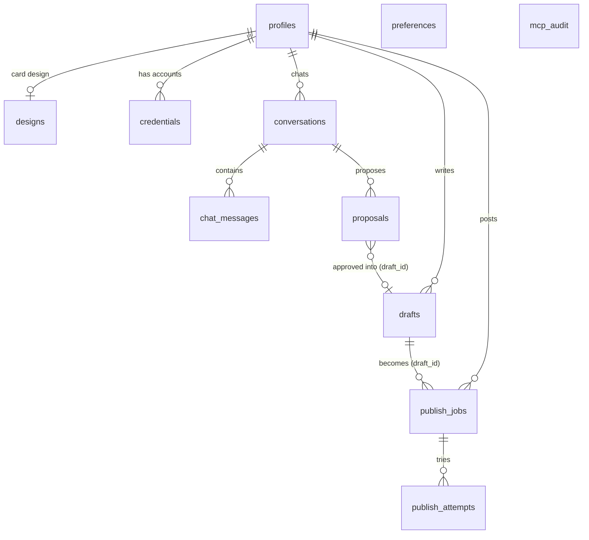

# Data model

CardPress keeps everything in one database: SQLite in a file by default, or Turso (libSQL) with `CARDPRESS_DB`. The schema is made of numbered migrations in `internal/store/migrations/`, applied in order at start-up and recorded in `schema_migrations`. This page describes the schema as it is, and notes what the next change adds. **It is updated with every migration.**

## Conventions

- Ids are 16 hex characters made by the server (`newID`). A brand's id is chosen when it is created.
- Times are UTC text in RFC 3339 (`2026-11-24T17:43:50Z`); drafts keep milliseconds. Text sorts correctly, so no date type is needed.
- Structured values are JSON text (`hashtags`, `doc`, `data`, `steps`). The shape of each is below. The server validates them on the way in.
- A brand owns its rows through `profile_id`. There are no database foreign keys: the services delete a brand's rows together (see `DeleteProfile`), inside one transaction.
- Secrets are never stored in plain text: `credentials.value` is sealed with the secret key (AES-GCM, tied to its network and field).

## Relationships

## Tables

### Brands and look

| Table | Migration | Columns |
|---|---|---|
| `profiles` | 0001, 0007 | `id` (PK), `position`, `data` (JSON: name, handle, website, logo, fonts, colour sets), `updated_at`, `archived_at` (set when a brand is archived, empty otherwise) |
| `designs` | 0001 | `profile_id` (PK), `data` (JSON: the brand's current card design), `updated_at` |
| `preferences` | 0001 | `key` (PK), `value` (JSON), `updated_at`. Keys: `theme`, `layout`, `customFonts`, `activeProfile`, `envProfile` |

`envProfile` names the brand that the `CARDPRESS_<NETWORK>_<FIELD>` environment variables belong to. It is set when the first brand is saved and is never moved.

### Writing

| Table | Migration | Columns |
|---|---|---|
| `drafts` | 0002 | `id` (PK), `profile_id`, `kind` (`post` or `article`), `status` (`draft`), `doc` (JSON, the editor's rich text), `hashtags` (JSON array), `alt_text`, `unicode_styles` (0/1), `created_at`, `updated_at`. Index `(profile_id, updated_at DESC)` |

`doc` is a TipTap/ProseMirror document: `{"type":"doc","content":[{"type":"paragraph","content":[{"type":"text","text":"…"}]}]}`. It is limited to 2 MB.

### Publishing

| Table | Migration | Columns |
|---|---|---|
| `publish_jobs` | 0004 | `id` (PK), `profile_id`, `draft_id`, `network` (`linkedin`), `status`, `body`, `hashtags` (JSON), `alt_text`, `image` (BLOB, the card PNG), `scheduled_at`, `timezone`, `error`, `post_urn`, `post_url`, `created_at`, `updated_at`, `published_at`. Indexes `(status, scheduled_at)` and `(profile_id, created_at DESC)` |
| `publish_attempts` | 0008 | `id` (PK), `job_id`, `started_at`, `finished_at`, `outcome`, `error`, `steps` (JSON). Index `(job_id, started_at)` |
| `credentials` | 0003, 0007 | `profile_id`, `network`, `field`, `value` (sealed), `updated_at`. Primary key `(profile_id, network, field)` |

A job is a snapshot: its `body`, `hashtags`, `alt_text` and `image` are copied when it is confirmed, so editing the draft later never changes what was sent. Statuses: `scheduled`, `publishing`, `published`, `failed`, `missed`, `needs_review`, `cancelled`.

`publish_attempts.steps` is a JSON array, one entry per call to LinkedIn: `{step, method, host, path, status, headers, body, error, at, ms}`. It holds LinkedIn's answer only: never the access token, and an upload address is kept without its query (it carries a signature). `headers` keeps a short list (`X-Restli-Id`, `X-Li-Uuid`, `Retry-After`, …).

### Assistant

| Table | Migration | Columns |
|---|---|---|
| `conversations` | 0005 | `id` (PK), `profile_id`, `title`, `session_id`, `source_kind`, `source_url`, `source_title`, `source_text`, `source_truncated`, `created_at`, `updated_at` |
| `chat_messages` | 0005 | `id` (PK), `conversation_id`, `seq`, `role` (`user` or `assistant`), `content`, `created_at`. Unique `(conversation_id, seq)` |
| `proposals` | 0005 | `id` (PK), `conversation_id`, `message_id`, `kind`, `title`, `body`, `hashtags`, `alt_text`, `rationale`, `status` (`pending`, `approved`, `rejected`), `edited`, `original`, `draft_id`, `created_at`, `decided_at` |

### Outside agents

| Table | Migration | Columns |
|---|---|---|
| `mcp_audit` | 0006 | `id` (autoincrement), `at`, `transport`, `caller`, `tool`, `args`, `outcome` (`ok` or `error`), `detail` |

## Migration history

| No. | Adds |
|---|---|
| 0001 | `profiles`, `designs`, `preferences` |
| 0002 | `drafts` |
| 0003 | `credentials` (one set per network) |
| 0004 | `publish_jobs` |
| 0005 | `conversations`, `chat_messages`, `proposals` |
| 0006 | `mcp_audit` |
| 0007 | Brands: `credentials` keyed by brand, `profiles.archived_at`, the `envProfile` preference |
| 0008 | `publish_attempts` |

## Next: the content workflow

Planned in `openspec/changes/2026-11-26-content-workflow`. `drafts` gains `title`, `design` (the item's own card design as typed JSON) with `design_version`, `approved_at`, `scheduled_at` and `timezone`, and `status` becomes `draft` → `approved` → `scheduled` → `published`. The document limit rises to 25 MB so an article can hold its images as base64. This page will be updated when that migration is written.
