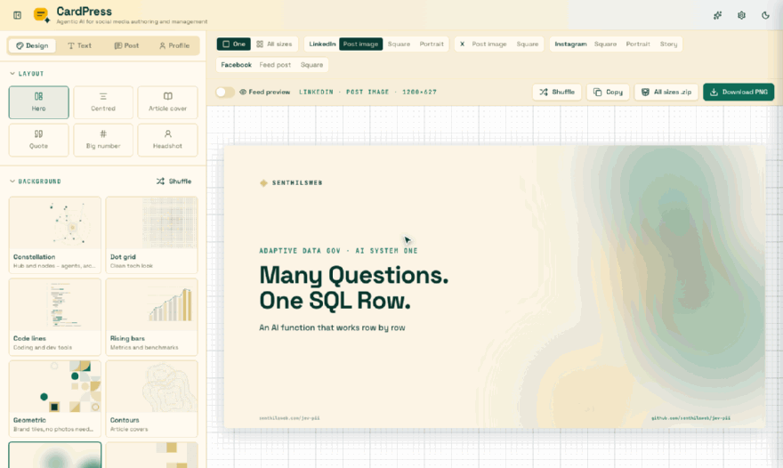

# Overview

CardPress is an open-source, self-hosted tool for writing and publishing social media posts. You design a branded card, draft the post text with an assistant, preview exactly what will be sent, and publish or schedule it yourself. It ships as one Go binary with the web app inside.

Using CardPress rather than running it? See the **User guide** inside the app, also published as the [web guide](https://www.senthilsweb.com/cardpress/guide/).

## What it does

- **Design cards** in your own brand: one profile (name, handle, logo, fonts), 28 colour sets, 6 layouts, 12 backgrounds drawn in code, and 10 sizes for LinkedIn, X, Instagram and Facebook. See [Workspace](workspace.md), [Palettes](palettes.md), [Fonts](fonts.md) and [Adding backgrounds](adding-backgrounds.md).
- **Write posts and articles** in a rich-text editor, with hashtags, alt text and a preview of the LinkedIn feed. See [Post authoring](post-authoring.md).
- **Draft with an assistant**: give it a web address or some text and it proposes a post or article. You approve, edit or reject each proposal. It prepares content only. See [Chat](chat.md) and [Claude Managed Agent](cma-agent.md).
- **Attach your own files**: your own image, several images, a PDF or a video from a public address in place of the card, with feed previews that follow what each network accepts. See [Publishing](publishing.md#your-own-images-or-pdf-in-place-of-the-card).
- **Publish or schedule to LinkedIn** from the full preview, with a queue and no automatic retries, and see it all on a month, week or day [Calendar](calendar.md). See [Publishing](publishing.md) and [Social accounts](social-settings.md).
- **Work as a team, or just you**: accounts with three roles (admin, editor, writer), a separate workspace for each person, an approval step before anything goes out, and a history of every item. See [Accounts and roles](accounts.md) and [Library](library.md).
- **Share articles and posts** as fast, server-rendered pages that social networks can preview. See [Public pages](public-pages.md).
- **Connect an outside agent** over MCP with an API key of your own. It can read your drafts and propose content, never publish. See [MCP](mcp.md).

## Principles

- **A person publishes.** The assistant and any MCP client end at a proposal. Nothing is posted without your click, and a failed post is never retried on its own.
- **Your data stays with you.** A SQLite file (or Turso) on your server holds everything. Social credentials are encrypted. Nothing is kept in the browser.
- **Safe by default.** It listens on loopback, refuses to expose the API without a token, and fetches web pages with an SSRF guard.
- **Honest about AI.** The assistant is opt-in, the screen names it, and without one the app says so.

## Status

| Area | State |
|---|---|
| Card designer, composer, full preview, exports | Built and tested |
| Encrypted credentials, scheduler | Built and tested |
| LinkedIn publishing: a post with its card | Built. A real post from a live server has succeeded |
| LinkedIn publishing: your own image, several images, a PDF, a video | Tested against a local fake of LinkedIn's API, **not yet against a real account**. Treat the first real post of each as a trial. See [Publishing](publishing.md) |
| X, Instagram and Facebook | Card sizes and feed previews. Publishing is not built (X and Instagram credentials can be stored) |
| Assistant | [Claude Managed Agents](cma-agent.md) write posts and articles from your sources; optional, off until set up |
| MCP server | Built and tested |

## Where to go next

- New here: [Getting Started](getting-started.md).
- Running it for real: [Deployment](deployment.md), [Configuration](configuration.md), [Operations](operations.md).
- Changing the code: [Code Tour](code-tour.md) and [Architecture](architecture.md).
- Looking something up: [Reference](reference.md).
